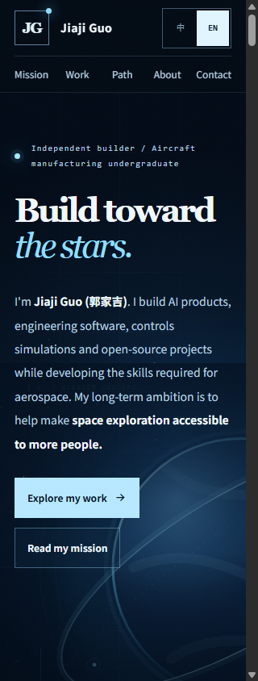

# Main-only corrective polish — 2026-11-06

Baseline: `1a0b6ed284b337da8384b18a9c16b0bf91264a78`.

## Scope

- Repair three literal newline escapes across the two READMEs; restore independent dsh-pilot and LocalMiniDrama table rows.
- Add an actual README gate and 44 mutation/valid-input regression cases to the existing CI. Preserve code examples, comments, CRLF files, escaped pipes and additional valid project rows.
- Keep the existing visual design. Fix 320px horizontal overflow, scale narrow English headings, retain native mobile navigation, hide unusable filters when JavaScript is disabled, and correct the Chinese QR direction wording.
- Update repository instructions to work directly on main, without new branches or force-pushes.

## Validation completed before push

- Full existing integrity checker: PASS. JavaScript syntax and git whitespace checks: PASS.
- README regression suite: 44 passed, zero failed.
- GitHub's own GFM renderer (POST /markdown): both original READMEs produced seven body rows and omitted LocalMiniDrama. Both corrected files produce eight three-cell body rows with that project visible; the Chinese introductory escape is gone.
- Headless Chrome browser: 115 passed, zero failed over two locales and six viewport widths. Checks cover actual available client width, heading text-range clipping, navigation/CTA clearance, all images, four project filters, locale switching, keyboard skip links, reduced motion and no-JavaScript content.
- Screenshot review: Chinese 390px hero, English 320px hero/contact and English 1440px hero. Two real screenshots are included below. These are responsive desktop-browser viewport tests, not claims about physical phone testing.

## Important test correction

The first browser run compared scroll width only with window.innerWidth and missed the classic scrollbar gutter at 320px. Screenshot inspection revealed the defect. Acceptance was tightened to documentElement.clientWidth and text-range clipping, then all cases were rerun. Do not use the initial 91-pass run as evidence that the original small-screen layout was correct.

## Evidence and limits

[Machine-readable results and source hashes](results.json) bind these checks to the source files in this commit. Existing QR data is unchanged. Real WeChat-client acceptance, Safari and Firefox have not been tested. No claim is made here that this unpushed source has already deployed: deployment must be checked against the actual pushed SHA separately.

Run the committed regression suite with:

```bash
node --check assets/stellar-site.js
node scripts/check-portfolio.mjs
node scripts/test-readme.mjs
git diff --check
```

## Reviewed browser captures

### English, 320 CSS pixels



### Chinese, 390 CSS pixels


